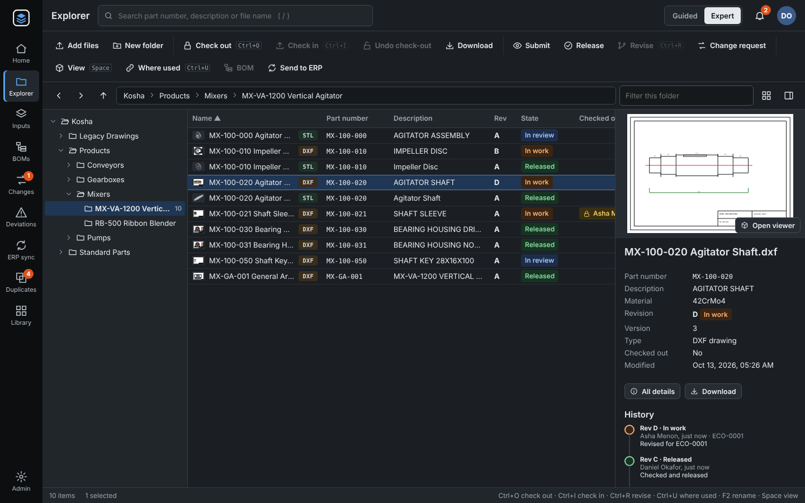

# Themes

Kosha's web client comes in four themes:

| Theme | What it looks like |
| --- | --- |
| **Same as my computer** (the default) | Light or Dark, following the light/dark setting of the computer or phone. Changes when that setting changes. |
| **Light** | Dark text on light backgrounds. |
| **Dark** | Light text on dark backgrounds. |
| **High contrast** | Black text on white with strong lines and outlined status chips. |

## Choosing a theme

Click your initials (top right) › **Theme**. The choice applies at once and is saved with your account, so it
follows you to other computers and browsers. Viewers can choose too.

Administrators set the theme for everyone who has not chosen one in **Admin › Users › Theme for everyone who
has not chosen one**. The Users table shows each person's choice ("Installation default" when they have not
chosen).

The drawing and 3D viewer, the preview strip and the sign-in artwork stay dark in every theme. In the revision
overlay, the drawings are compared on white paper, so red (older) and blue (this version) mix to purple where
lines match.

The Office task pane follows the Office theme (for example *Black* or *Dark Gray* make it dark). When Office does
not tell, as in the pane's test mode in a browser, it follows the computer.

## API

| Call | What it does |
| --- | --- |
| `POST /api/auth/theme` `{"theme": "dark"}` | Your own theme: `system`, `light`, `dark` or `contrast`; `""` goes back to the installation's default. |
| `GET /api/auth/me`, `POST /api/auth/login` | `user.ui_theme` (your choice, `""` when none) and `default_theme` (the installation's). |
| `PUT /api/settings` `{"default_theme": "light"}` | The installation's default (admins). |
| `PATCH /api/users/{id}` `{"ui_theme": "contrast"}` | Another user's theme (admins). |

The column is `users.ui_theme`, added by the database change `m20261013_1700_users_theme`.

## For developers

- **Colours only through CSS variables.** Every colour of the web client is a variable in `:root` of
  `web/app.css`. Scripts never hold colour literals: use a class, or `var(--name)` in an inline style.
  `server/tests/test_themes.py` fails on any `#hex`, `rgb()` or `hsl()` in `web/js/*.js`, and on colours outside
  variable definitions in `web/app.css`, `web/inputs.css` and `web/office-addin/taskpane.css`.
- **Adding a colour:** define it in the light `:root` block, then in the Dark block (twice: the chosen block
  `:root[data-theme="dark"]` and the one inside `@media (prefers-color-scheme: dark)`, which must stay identical;
  the test checks), and in `:root[data-theme="contrast"]` when the light value is not strong enough. If text is
  drawn on it, add the pair to `APP_PAIRS` in the test: every pair must reach WCAG AA (4.5:1) in every theme,
  and body text 7:1 in High contrast.
- **Before the first paint**, `web/js/theme-boot.js` (a plain script in `<head>`, since the Content-Security-Policy
  forbids inline scripts) sets `data-theme` on `<html>` from the value remembered in this browser
  (`localStorage["kosha.theme"]`). After sign-in, the account's choice replaces it (`web/js/theme.js`).
- **Native controls** (scroll bars, date pickers, check boxes) follow through `color-scheme`, set in each theme.
- `scripts/smoke_ui.py` opens every screen in `SCREENS` in the light and in the dark theme; in dark it fails when
  the page is not dark or an element still has a white background.
